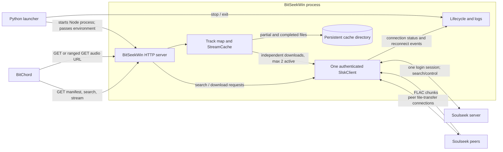

# BitSeekWin architecture

This document describes the architecture implemented in the current source,
not a proposed design. The BitChord protocol summary follows the
[official BitChord add-on documentation](https://bitchord.kushagrasingh.in/docs).
Implementation details were checked against `direct_server.mjs`,
`stream_cache.mjs`, `launcher.py`, and the installed `slsk-client` 2.0.2
download implementation.

## System overview

BitSeekWin is an HTTP add-on bridge. It does not expose a JavaScript add-on
module inside BitChord. The public source URL contains a path slug and a
bearer secret; all add-on routes are under that prefix. The Node HTTP server
listens on `0.0.0.0` and uses `PUBLIC_BASE_URL` when constructing the playable
audio URL.

## BitChord add-on protocol

The official protocol uses three JSON-over-HTTP GET endpoints:

1. **Manifest — `GET /manifest.json`**
   - Provide a stable, unique non-empty `id`; a human-readable `name` and
     `version` are recommended.
   - Advertise `resources: ["search", "stream"]` for this endpoint-based flow.
   - `allowDownloads` is optional in BitChord and defaults to allowed when
     omitted. BitSeekWin explicitly reports a boolean, defaulting to `false`;
     the launcher has the same default.
   - Optional `settings` can define a quality picker using
     `{ "key": "quality", "type": "select", "options": [...] }`; BitChord sends
     the selected option on search and stream requests. The official protocol
     also defines the optional `checkValidLossless` gate. BitSeekWin does not
     currently implement these features.

2. **Search — `GET /search?q=...`**
   - Return a JSON object with a `tracks` array. Track `id` and `title` are
     required by BitChord; `artist`, `album`, `duration`, `format`,
     `audioQuality`, artwork, and a direct `streamURL` are optional or
     recommended according to the official contract.
   - BitChord may send a `quality` parameter and other hints such as `atmos`.
     Search responses should be focused and fast; the official protocol does
     not define a result-count parameter.
   - BitSeekWin returns the standard `tracks`, `albums`, `artists`, and
     `playlists` arrays. It filters to safe `.flac` Soulseek results, ranks
     candidates by filename match, and returns at most 50 tracks. It reports
     an empty set of arrays for an empty query or no usable match.

3. **Stream — `GET /stream/{id}`**
   - Return JSON with an absolute, directly playable media or manifest `url`.
     Codec, container, manifest kind, encryption, and audio-quality metadata
     are recommended when known.
   - BitChord may send the selected `quality` and other hints to this route.
   - BitSeekWin returns a URL to its own `/file/{id}` route and declares FLAC
     format, codec, container, MIME type, and lossless quality. Unknown or
     expired track IDs return 404.

The separate `/file/{id}` route is BitSeekWin's media transport endpoint, not
a fourth add-on resource. It returns FLAC bytes and supports byte ranges for
playback, seeking, and follow-up requests. BitSeekWin also accepts `HEAD` and
`OPTIONS` on the HTTP server; these do not replace the three GET protocol
routes.

## Search and track identity

The server normalizes query punctuation and common Latin diacritics before
searching Soulseek. It makes one missing-vowel recovery search only when an
initial search returns no results and the query contains a likely compressed
consonant cluster. Search requests time out after two seconds.

Only safe, positive-size FLAC results with a peer username are considered.
Candidate titles and artist names are inferred from filenames and the query;
full file tags are not read. Results are ordered by filename match, available
peer slots, reported speed, queue length, and stable ID. A track ID is a
truncated SHA-256 digest of peer username, remote filename, and size. Track
records remain resolvable for 20 minutes after their latest search, stream, or
file request, covering BitChord's documented 10-minute search and 5-minute stream
caches. Expired records are pruned on search. The server does not evict still
valid IDs or IDs used by active HTTP consumers/transfers to make room: if the
1,000-record registry is full, a new search receives HTTP 503 rather than
results that cannot be streamed. Repeated searches do not clear prior results.

Searches and stream/file requests receive diagnostic correlation IDs. Logs
include result IDs, peer and filename resolution, byte ranges, transfer reuse
or slot availability, peer transfer status, and HTTP outcomes. Stream requests
refer back to the most recent search-request IDs associated with that result.

## Soulseek client and transfer lifecycle

The Node server creates one `SlskClient` during startup and calls its login
once. Searches and all per-track downloads use that client. The client
maintains the authenticated Soulseek session and centrally reports server
disconnect, reconnect, and replacement-login events. File transfers still
require peer connections; “one client” does not mean every track shares one
peer socket.

Each cache entry has its own transfer state: peer/file identity, received-byte
position, partial-file path, active download, HTTP consumer count, errors, and
cleanup timers. Searching for another track does not cancel a transfer.
Different tracks may download concurrently, with a hard default maximum of
two active transfers. Searches and completed cache reads do not consume those
download slots. A simultaneous transfer for the same peer/path with
conflicting size metadata is rejected rather than replacing the library's
download for that peer/path.

An HTTP request adds a consumer for its track. If a response closes, its
readable is destroyed and only that consumer is removed. The transfer remains
available to other consumers. Once the last consumer disconnects, an active
transfer gets a 30-second default grace period. If nobody reconnects, that
transfer is canceled and releases its slot; its partial bytes are retained.
Transfers also have a 15-minute timeout. A server shutdown cancels outstanding
transfers and waits for them to release before destroying the client.

## Streaming, byte ranges, and partial data

The HTTP handler resolves the track ID, parses a single byte range, and
connects the response to a `Readable` backed by `StreamCache.readRange()`.
That generator reads available bytes from disk in bounded chunks and waits for
more bytes when the requested region has not arrived yet. Multiple HTTP range
requests for the same track read the same transfer's contiguous bytes; a new
track has a separate entry and download.

`HEAD` reports known file metadata without opening a Soulseek transfer. Invalid
or unsatisfiable ranges receive 416. Responses use `audio/flac` and
`Accept-Ranges: bytes`. While data is incomplete, a ranged GET does not claim
the complete representation size in `Content-Range`; a completed cached file
reports the actual total size. For GET requests, response headers are sent only
when the first audio bytes are available. A peer failure before the first byte
can therefore return HTTP 502; a failure after streaming starts is logged and
the already-started response is terminated.

Partial files are retained in the cache directory. The installed
`slsk-client` supports an `offset` download option, and BitSeekWin starts a
subsequent transfer at the contiguous partial-file length. The library itself
also retries interrupted downloads at its received offset. A partial entry is
never treated as completed merely because it has bytes: completion requires a
successful peer download and an exact match to the expected file size. The
partial file is then atomically renamed to the completed `.flac` cache file.

## Persistent FLAC cache

Cache identity is SHA-256 over peer username, remote filename, and file size,
so a new BitChord track ID can reuse an existing entry when those fields are
the same. The default cache location is `%LOCALAPPDATA%\\BitSeekWin\\cache` on
Windows and `~/.cache/BitSeekWin/cache` elsewhere.

Completed files and partial files have metadata persisted beside them and
survive process restarts. Defaults are a 30-minute expiration since last
access and a 2 GiB maximum. Inactive entries are removed by expiry or
least-recently-used eviction; entries with active HTTP consumers or transfers
are protected. The directory, TTL, and maximum size can be changed through
`BITSEEKWIN_CACHE_DIRECTORY`, `BITSEEKWIN_CACHE_TTL_MS`, and
`BITSEEKWIN_CACHE_MAX_BYTES`. The idle transfer grace period can be changed
with `BITSEEKWIN_IDLE_TRANSFER_TIMEOUT_MS`.

## Memory and size limits

Disk-backed streaming and caching do **not** make Soulseek downloads
memory-free. In the installed `slsk-client` 2.0.2 implementation, each download
retains received chunks in memory and concatenates them when the download
completes. BitSeekWin rejects files larger than 128 MiB and allows at most two
active transfers, but two near-limit downloads can still consume substantial
memory, including extra peak use during concatenation. The disk cache is for
stream delivery and reuse; it does not replace the library's buffers.

## Launcher lifecycle

The Python launcher starts `direct_server.mjs` as a child Node process. It
passes the Soulseek username and password, the generated source secret, public
URL, port, word settings, and download-permission choice through the child
process environment. The password is not written to the launcher settings
file. The launcher reads the server's combined output for status and
diagnostics.

The browser dashboard shows setup controls, the generated source URL, and the
activity log. It polls the launcher's loopback-only `/api/status` endpoint for
launcher state and logs. It does not show a live-monitoring panel or operational
status footer, and it does not poll the add-on server's monitoring endpoint.
That authenticated endpoint remains implemented by the Node server and exposes
connection, transfer-slot, cache, and transfer snapshots; removing the
dashboard panel did not remove the backend endpoint or monitoring data source.
The existing public-address input is saved in browser `localStorage` after a
successful start request and restored when the dashboard is reopened.

The Node process authenticates before opening the HTTP listener and printing
the source URL. The Node process installs `SIGINT` and `SIGTERM` handlers; when
one is delivered, its shutdown path closes HTTP connections, cancels and
drains active cache transfers, destroys the Soulseek client, and exits. The
launcher Stop action calls `Popen.terminate()` for the child process. On
Windows, this can terminate the process without delivering a JavaScript
shutdown signal, so graceful cache/transfer cleanup is not guaranteed by that
launcher action. A configured Tailscale Funnel remains configured when the
launcher stops BitSeekWin.

## Implemented behavior versus known limitations

### Implemented

- One authenticated Soulseek client per server process, shared by searches and
  independent peer-file transfers.
- Two active transfer slots by default, per-track consumers, disconnect grace
  period, per-transfer timeout, and transfer cleanup.
- FLAC candidate filtering and ranking, direct HTTP audio streaming, range
  requests, partial-file offset reuse, and persistent completed-file caching.
- Cache expiry and LRU size management with active-entry protection.
- Download permission advertised in the manifest, off by default.

### Known compatibility gaps and limitations

- **Quality tiers are ignored.** BitChord documents sending `quality` on both
  search and stream requests. BitSeekWin currently reads only the search `q`
  parameter and always searches/returns FLAC lossless results, regardless of
  a requested tier such as `HIGH` or `LOW`. The stream handler likewise
  returns FLAC without negotiating the query parameter.
- **Manifest IDs may collide.** The current ID is
  `bitseekwin-addon.${slug}`; with the default slug, independent installations
  report the same ID. The official docs require a stable, unique ID. Setting
  a distinct slug also changes this ID, but there is no generated per-install
  identity mechanism.
- The server caps each search response at 50 tracks; BitChord's protocol does
  not define a result limit parameter.
- Soulseek peers may be offline, queue or refuse transfers, disconnect, or
  provide data that differs from the search result. Actual playback and
  offset-resume behavior depends on the peer, network, library, and BitChord
  client and needs live testing.
- The library's in-memory buffering and the 128 MiB/two-transfer limits mean
  peak memory can still be high. Disk caching does not remove this limitation.
- On Windows, stopping the child through the launcher may bypass Node's
  graceful shutdown handlers; partial files remain on disk, but active
  transfers may not be drained before process termination.

### Future improvements (not implemented)

- Honor or explicitly negotiate BitChord quality tiers, while accurately
  describing the formats BitSeekWin can actually provide.
- Provide a unique, stable manifest ID per configured installation, if the
  product is intended to support multiple instances in one BitChord install.
- Reduce or eliminate library-level in-memory buffering if the Soulseek
  library or a future supported implementation permits safe disk streaming.
- Test transfer resume, repeated ranges, and playback/disconnect behavior with
  live Soulseek peers and BitChord devices.
