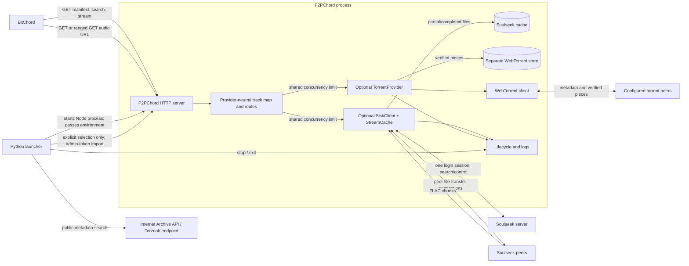

# P2PChord architecture

This document describes the implemented architecture and labels planned work
separately. The BitChord protocol summary follows the
[official BitChord add-on documentation](https://bitchord.kushagrasingh.in/docs).
Implementation details were checked against `direct_server.mjs`,
`stream_cache.mjs`, `launcher.py`, and the installed `slsk-client` 2.0.2
download implementation.

## System overview

P2PChord is an HTTP add-on bridge. It does not expose a JavaScript add-on
module inside BitChord. A source URL contains a path slug and a route
credential; all add-on routes are under that prefix. Localhost and custom
non-LAN URLs use a separate random 128-bit bearer token. Launcher LAN mode
uses only the randomly generated adjective/noun phrase as that route
credential. The Node HTTP server binds to `127.0.0.1` by default; launcher LAN
mode binds only to the detected private LAN address. `PUBLIC_BASE_URL` is used
when constructing the playable audio URL. The external identifier,
`P2PCHORD_*` environment variables, and `%LOCALAPPDATA%\P2PChord` storage
namespace are now P2PChord-specific. This rename is breaking: prior environment
variables, add-on IDs, source URL slugs, and storage paths are not migrated;
existing cache directories are left untouched.

## BitChord add-on protocol

The official protocol uses three JSON-over-HTTP GET endpoints:

1. **Manifest — `GET /manifest.json`**
   - Provide a stable, unique non-empty `id`; a human-readable `name` and
     `version` are recommended.
   - Advertise `resources: ["search", "stream"]` for this endpoint-based flow.
   - `allowDownloads` is optional in BitChord and defaults to allowed when
     omitted. P2PChord explicitly reports a boolean, defaulting to `false`;
     the launcher has the same default. BitChord deliberately omits an add-on
     from download-source selection when this value is false, while playback
     can still use it. Enabling the launcher option or setting
     `P2PCHORD_ALLOW_DOWNLOADS=true` makes BitChord eligible to use the
     existing stream URL for a download; refresh or re-add the source after
     changing the manifest setting.
   - Optional `settings` can define a quality picker using
     `{ "key": "quality", "type": "select", "options": [...] }`; BitChord sends
     the selected option on search and stream requests. The official protocol
     also defines the optional `checkValidLossless` gate. P2PChord does not
     currently implement these features.

2. **Search — `GET /search?q=...`**
   - Return a JSON object with a `tracks` array. Track `id` and `title` are
     required by BitChord; `artist`, `album`, `duration`, `format`,
     `audioQuality`, artwork, and a direct `streamURL` are optional or
     recommended according to the official contract.
   - BitChord may send a `quality` parameter and other hints such as `atmos`.
     Search responses should be focused and fast; the official protocol does
     not define a result-count parameter.
   - P2PChord returns the standard `tracks`, `albums`, `artists`, and
     `playlists` arrays. It filters safe `.flac` results from enabled providers
     and, by default, ranks candidates by filename match and returns at most 50
     tracks. BitTorrent searches only torrents already imported by the user.
     Fastest-speed mode returns one result using the source's reported or
     observed transfer speed. Empty queries and searches without a usable
     match return empty arrays.

3. **Stream — `GET /stream/{id}`**
   - Return JSON with an absolute, directly playable media or manifest `url`.
     Codec, container, manifest kind, encryption, and audio-quality metadata
     are recommended when known.
   - BitChord may send the selected `quality` and other hints to this route.
   - P2PChord returns a URL to its own `/file/{id}` route and declares FLAC
     format, codec, container, MIME type, and lossless quality. Unknown or
     expired track IDs return 404.

The separate `/file/{id}` route is P2PChord's media transport endpoint, not
a fourth add-on resource. It returns FLAC bytes and supports byte ranges for
playback, seeking, and follow-up requests. P2PChord also accepts `HEAD` and
`OPTIONS` on the HTTP server; these do not replace the three GET protocol
routes.

The inspected BitChord add-on API has no independent torrent selection or
import action. P2PChord therefore keeps discovery in its launcher dashboard:
results are displayed there, and an explicit **Import selected torrent** action
hands that single magnet or bounded `.torrent` metadata to the existing
provider. Only after that succeeds can the imported torrent's FLAC files appear
beside Soulseek results in BitChord's normal search response.

## Search and track identity

The server normalizes query punctuation and common Latin diacritics before
searching Soulseek. When enabled, it makes one missing-vowel recovery search
only when an initial search returns no results and the query contains a likely
compressed consonant cluster. The launcher exposes this retry as a checkbox.
Each Soulseek query has a configurable timeout, defaulting to two seconds.
The launcher exposes integer seconds from 1 to 30; the server also accepts
direct settings from 500 to 30,000 milliseconds.

Only safe, positive-size FLAC results from enabled providers are considered.
Candidate titles and artist names are inferred from filenames and the query;
full file tags are not read. The launcher defaults to match-first selection:
results are ordered by filename match, available peer slots, reported or
observed speed,
queue length, and stable ID, and up to 50 are returned for BitChord to select.
The launcher can lower the result limit to 1.
The launcher can be set to fastest-speed mode, which returns only the result
from matching results. Soulseek speed is self-reported; BitTorrent speed is
observed by WebTorrent. Neither guarantees playback throughput, and
fastest-speed mode can return a less relevant result than a closer match.
Soulseek track IDs are truncated SHA-256 digests of peer username, remote
filename, and size. Torrent track IDs are provider-prefixed hashes of torrent
info hash and file index, keeping the provider identities separate. Track
records remain resolvable for 20 minutes after their latest search, stream, or
file request, covering BitChord's documented 10-minute search and 5-minute stream
caches. Expired records are pruned on search. The server does not evict still
valid IDs or IDs used by active HTTP consumers/transfers to make room: if the
1,000-record registry is full, a new search receives HTTP 503 rather than
results that cannot be streamed. Repeated searches do not clear prior results.

Searches and stream/file requests receive diagnostic correlation IDs. Logs
include result IDs, peer and filename resolution, byte ranges, transfer reuse
or slot availability, peer transfer status, and HTTP outcomes. Streaming
milestones report elapsed time from HTTP request receipt through slot
acquisition, `slsk-client.download()`, peer status/data, first cache write,
cache readability, and the first body write queued to Node's HTTP response.
That final milestone is not a measurement of delivery over the network to
BitChord. Stream requests refer back to the most recent search-request IDs
associated with that result.

## Torrent discovery and explicit import

Discovery is disabled by default and implemented in `torrent_discovery.py`
using Python's standard-library HTTP and XML/JSON parsers. The built-in
Internet Archive path queries its public advanced-search and metadata APIs.
General-purpose indexers use the Torznab RSS API format; the user supplies an
HTTPS endpoint and optional API key. P2PChord does not scrape HTML, install
Prowlarr/Jackett, or bypass authentication and anti-bot controls.

The parsers normalize title, artist, album, format, size, seeders, leechers,
source, info hash, and available magnet/download/source URLs. Results without
a valid info hash or an importable magnet/`.torrent` link are discarded.
Duplicates collapse by normalized info hash. Ranking prioritizes FLAC, then
query-term overlap, then reported seeders. Archive metadata exposes no live
seeder counts; those values remain unknown.

Requests have a configurable 1–30 second per-request timeout, a 2 MiB response
limit, at most two concurrent HTTP requests, a one-request-per-second
per-host rate limit, and a 60-second result cache. Torznab endpoints must use
HTTPS, resolve only to public IP addresses, and may redirect only to the same
host. Internet Archive requests and selected torrent downloads may redirect
within `archive.org`; other download URLs reject cross-host redirects. Torrent
metadata is downloaded only after the user selects Import and is capped at
2 MiB. Search can be cancelled from the launcher; an in-flight standard-library
HTTP request can take up to its configured timeout to return.

The launcher holds result IDs and the short-lived admin credential in memory.
The Node server's import route requires both the normal source path credential
and that separate random token. It only forwards a user-selected result to
`TorrentProvider.addSource`; that provider retains its source-count, metadata
size, aggregate storage, file-count, path, and FLAC checks. WebTorrent's
existing deselected startup and piece verification remain unchanged. The
selected torrent is active for this server session; discovery selections are
not persisted as launcher settings and must be imported again after restart.

The Internet Archive API and a sample item's metadata/torrent URL were
reachable during implementation. Torznab parsing and failure cases are tested
with fixtures; no live Torznab endpoint was used. Search results and the
launcher-to-provider handoff are not proof of live peer availability or
successful BitChord playback.

## Soulseek client and transfer lifecycle

The Node server creates one `SlskClient` during startup and calls its login
once. Searches and all per-track downloads use that client. The client
maintains the authenticated Soulseek session and centrally reports server
disconnect, reconnect, and replacement-login events. File transfers still
require peer connections; “one client” does not mean every track shares one
peer socket.

Each cache entry has its own transfer state: peer/file identity, received-byte
position, partial-file path, active download, HTTP consumer count, errors, and
cleanup timers. Searching for another track does not cancel a transfer.
Different tracks may download concurrently, with a default of two active
transfers. The launcher can lower this to one, and neither the launcher nor
the server accepts a limit above two. Searches and completed cache reads do
not consume those download slots. The launcher can lower the per-track stream
size limit from its 128 MiB default, but cannot raise it. A simultaneous
transfer for the same peer/path with conflicting size metadata is rejected
rather than replacing the library's download for that peer/path.

An HTTP request adds a consumer for its track. If a response closes, its
readable is destroyed and only that consumer is removed. The transfer remains
available to other consumers. Once the last consumer disconnects, an active
transfer gets a configurable grace period (30 seconds by default, adjustable
from 1 to 600 seconds in the launcher). If nobody reconnects, that transfer is
canceled and releases its slot; its partial bytes are retained.
Transfers also have a 15-minute overall timeout. By default, a new transfer is
cancelled if no peer audio chunk arrives within 30 seconds; peer-connection
inactivity also times out after 30 seconds. These deadlines are separately
configurable with `P2PCHORD_FIRST_BYTE_TIMEOUT_MS` and
`P2PCHORD_PEER_IDLE_TIMEOUT_MS` (1–300 seconds). A server shutdown cancels
outstanding transfers and waits for them to release before destroying the
client.

## Streaming, byte ranges, and partial data

The HTTP handler resolves the track ID, parses a single byte range, and
connects the response to a `Readable` backed by `StreamCache.readRange()`.
That generator reads available bytes from disk in bounded chunks and waits for
more bytes when the requested region has not arrived yet. Multiple HTTP range
requests for the same track read the same transfer's contiguous bytes; a new
track has a separate entry and download.

Received chunks are written to the cache in order through one serialized
write queue per file. The first chunk is flushed immediately; subsequent
chunks are grouped up to 128 KiB or flushed after at most 1 ms. Batches use
`FileHandle.writev()` when there are multiple chunks and continue at the exact
byte offset if the OS reports a partial write. The cache's readable byte
position advances only after the batch is written, so HTTP readers never see
unpersisted bytes. `Readable.pipe(response)` maintains HTTP backpressure
independently of disk batching.

`HEAD` reports known file metadata without opening a Soulseek transfer. Invalid
or unsatisfiable ranges receive 416. Responses use `audio/flac` and
`Accept-Ranges: bytes`. While data is incomplete, a ranged GET does not claim
the complete representation size in `Content-Range`; a completed cached file
reports the actual total size. For GET requests, response headers are sent only
when the first audio bytes are available. A peer failure before the first byte
can therefore return HTTP 502; a failure after streaming starts is logged and
the already-started response is terminated.

Partial files are retained in the cache directory. The installed
`slsk-client` supports an `offset` download option, and P2PChord starts a
subsequent transfer at the contiguous partial-file length. The library itself
also retries interrupted downloads at its received offset. A partial entry is
never treated as completed merely because it has bytes: completion requires a
successful peer download and an exact match to the expected file size. The
partial file is then atomically renamed to the completed `.flac` cache file.

## Persistent FLAC cache

Cache identity is SHA-256 over peer username, remote filename, and file size,
so a new BitChord track ID can reuse an existing entry when those fields are
the same. The default cache location is `%LOCALAPPDATA%\P2PChord\cache` on
Windows and `~/.cache/P2PChord/cache` elsewhere. Torrent data uses the
separate `%LOCALAPPDATA%\P2PChord\torrents` store by default.

Completed files and partial files have metadata persisted beside them and
survive process restarts. Defaults are a 30-minute expiration since last
access and a 2 GiB maximum. The launcher can adjust both values for the
current launch only (TTL: 1–10,080 minutes; size: 16–32,768 MiB). Inactive
entries are removed by expiry or least-recently-used eviction; entries with
active HTTP consumers or transfers
are protected. The directory, TTL, and maximum size can be changed through
`P2PCHORD_CACHE_DIRECTORY`, `P2PCHORD_CACHE_TTL_MS`, and
`P2PCHORD_CACHE_MAX_BYTES`. The launcher exposes the TTL, size, and idle
transfer grace period; all launcher settings are per launch and default to
the current behavior when not provided.

## Memory and size limits

Disk-backed streaming and caching do **not** make Soulseek downloads
memory-free. In the installed `slsk-client` 2.0.2 implementation, each download
retains received chunks in memory and concatenates them when the download
completes. P2PChord rejects files larger than its configurable per-track
limit (128 MiB by default, not configurable above 128 MiB) and allows one or
two active transfers, but two near-limit downloads can still consume substantial
memory, including extra peak use during concatenation. The disk cache is for
stream delivery and reuse; it does not replace the library's buffers.

## Launcher lifecycle

The Python launcher starts `direct_server.mjs` as a child Node process. It
passes the Soulseek username and password, the generated source secret, public
URL, word settings, source-selection mode, search controls, cache limits, and
transfer limits through the child process environment. These are validated
for each launch and are not persisted by the launcher. Defaults preserve the
existing search, cache, and transfer behavior, including the two-transfer
ceiling and 128 MiB per-track cap. The password is not written to the launcher
settings file. The launcher reads the server's combined output for status and
diagnostics.

The launcher can detect a private IPv4 address and advertise
`http://<LAN-IP>:8080` for another device on the same network. This mode uses
the randomized adjective/noun route phrase without the separate random token;
the phrase remains the URL's route credential, with less entropy than the
normal 128-bit token. Localhost and custom/Tailscale URLs retain the 128-bit
token. The server still binds on all interfaces, so LAN access should be
limited by Windows Firewall to Private networks.

The browser dashboard shows setup controls, the generated source URL, and the
activity log. It polls the launcher's loopback-only `/api/status` endpoint for
launcher state and logs. It does not show a live-monitoring panel or operational
status footer, and it does not poll the add-on server's monitoring endpoint.
That authenticated endpoint remains implemented by the Node server and exposes
connection, transfer-slot, cache, and transfer snapshots; removing the
dashboard panel did not remove the backend endpoint or monitoring data source.
The existing public-address input is saved in browser `localStorage` after a
successful start request and restored when the dashboard is reopened.

The Node process authenticates before opening the HTTP listener and printing
the source URL. The Node process installs `SIGINT` and `SIGTERM` handlers; when
one is delivered, its shutdown path closes HTTP connections, cancels and
drains active cache transfers, destroys the Soulseek client, and exits. The
launcher Stop action calls `Popen.terminate()` for the child process. On
Windows, this can terminate the process without delivering a JavaScript
shutdown signal, so graceful cache/transfer cleanup is not guaranteed by that
launcher action. When the launcher configured Tailscale Funnel, it disables
that endpoint on stop.

## Provider lifecycle and BitTorrent

Soulseek remains enabled by default and continues to use one authenticated
`SlskClient` plus `StreamCache`. BitTorrent is an optional, experimental
provider implemented in `torrent_provider.mjs`; it is disabled by default.
The launcher supports Soulseek-only, BitTorrent-only, or both. Provider-neutral
search results include a `provider` field, and torrent IDs are prefixed to keep
them distinct from Soulseek cache identities. The HTTP stream descriptor and
range-capable `/file/{id}` route dispatch to the provider that created the
track. A shared `TransferBudget` limits active transfers across both providers.

The torrent provider accepts user-configured magnet URIs with a `btih` info
hash, absolute local `.torrent` paths, or metadata buffers submitted by the
launcher after explicit result selection (all metadata is capped at 2 MiB).
It adds at most eight sources, rejects torrents with over 10,000
files and unsafe file paths, and
returns only size-limited `.flac` files whose filenames contain every query
term. WebTorrent 3.0.21 provides the
magnet/metadata client and range-readable file streams. WebTorrent verifies
piece hashes before exposing those pieces to readers. Torrent files use a
separate persistent piece store and do not enter the Soulseek cache.

The WebTorrent client explicitly disables UPnP and NAT-PMP, sets uploads to
zero, caps peer connections, disables local peer discovery and web seeds, and
starts with torrent files deselected. Reading an incomplete file selects its
pieces; when readers become idle, selection is removed while stored verified
pieces remain.
The source manager limits aggregate declared torrent size, candidate file size,
source count, and active transfer count. The launcher defaults to a 4 GiB
aggregate torrent-size limit and a 128 MiB per-track limit. These limits are
not claims about measured disk consumption or network throughput.

The `libtorrent` npm binding inspected during library selection was version
0.0.3, a legacy native Node addon with uncertain Windows build and maintenance
status. WebTorrent was selected to avoid that native build path, not because
its Windows networking or large-swarm behavior has been validated here.

## Implemented behavior versus known limitations

### Implemented

- Optional provider startup, Soulseek enabled by default, BitTorrent disabled
  by default, and conditional Soulseek credentials.
- Provider-neutral FLAC search, stable provider-separated track identities,
  shared transfer concurrency, stream routing, monitor data, and cancellation
  of HTTP readers.
- Soulseek search/transfer behavior, persistent partial/completed cache,
  byte-range service, offset resume, FLAC signature validation, and size checks.
- User-configured magnet and local `.torrent` inputs, filename matching, and
  WebTorrent piece-aware range reads.
- Experimental Internet Archive and Torznab metadata discovery in the
  launcher, with explicit result selection before import into TorrentProvider.
- Per-client search rate limiting, signed media URLs when BitChord proof auth
  is enabled, and source URL path authentication.

### Known limitations

- **No live BitTorrent peer or BitChord playback validation has been performed.**
  Current automated tests use local/synthetic data; availability, first-byte
  latency, repeated range behavior, and cancellation against real swarms remain
  unverified.
- **Live Torznab compatibility is unverified.** RSS parsing and failure handling
  use fixtures. A configured endpoint must permit automated HTTPS requests;
  results may omit seed/leech counts, usable magnets, FLAC metadata, or live
  peers. Discovery metadata does not establish a user's rights to a release.
- **Android cleartext policy blocks the plain-HTTP LAN URL.** The inspected
  BitChord Android manifest sets `android:usesCleartextTraffic="false"`.
  P2PChord cannot override that client-side policy. BitChord would need a
  user-approved, host-scoped LAN cleartext exception, or the connection must
  use HTTPS trusted by Android. Do not disable cleartext protection globally.
- **Quality tiers are ignored.** BitChord sends `quality` on search and stream
  requests, but P2PChord always returns FLAC regardless of a requested tier.
- The default manifest ID `p2pchord-addon.${slug}` may collide between
  independent installations; a distinct slug changes the ID, but there is no
  generated per-install identity mechanism.
- Searches are capped at 50 results. BitChord's protocol does not define a
  result-count parameter.
- Soulseek peers may queue, refuse, disconnect, or return mismatched data.
  Torrent peers and trackers may be unavailable or slow. P2PChord does not
  automatically switch sources mid-transfer; doing so could corrupt ranges or
  resumed data if files differ.
- Disabling NAT mappings and uploads does not hide the user's public IP from
  BitTorrent trackers or connected peers, and a local peer listener may still
  be opened. Users must import only torrents they are authorized to access.
- The npm audit performed during this work reported four HIGH advisories
  through `ip@2.0.1` (`GHSA-2p57-rm9w-gvfp`), with no patched version offered
  by npm at that time. A forced WebTorrent downgrade was not applied; the
  dependency tree should not be described as audit-clean.
- `slsk-client` retains received chunks in memory and concatenates them at
  transfer completion. The existing 128 MiB/two-transfer limits still permit
  high memory use. Torrent storage is separate and disk-backed.
- Synthetic server tests cover the manifest/stream/file handoff, but actual
  playback, seeking, downloads, and compatibility across installed BitChord
  releases require device and peer testing.
- On Windows, launcher Stop may terminate the child without delivering a
  graceful Node shutdown signal, so active transfers may not be drained.

### Future improvements (not implemented)

- Run live Soulseek and BitTorrent peer tests for first-byte latency, real
  range seeking, peer timeouts, storage persistence, and transfer cancellation.
- Test playback/download/range behavior on the BitChord versions users actually
  have installed.
- Honor or explicitly negotiate BitChord quality tiers and consider a unique
  stable manifest ID per installation.
- Reassess the flagged transitive dependency when a compatible patched release
  becomes available; do not force a downgrade without compatibility testing.
- Reduce library-level in-memory buffering if a safe supported approach exists.
